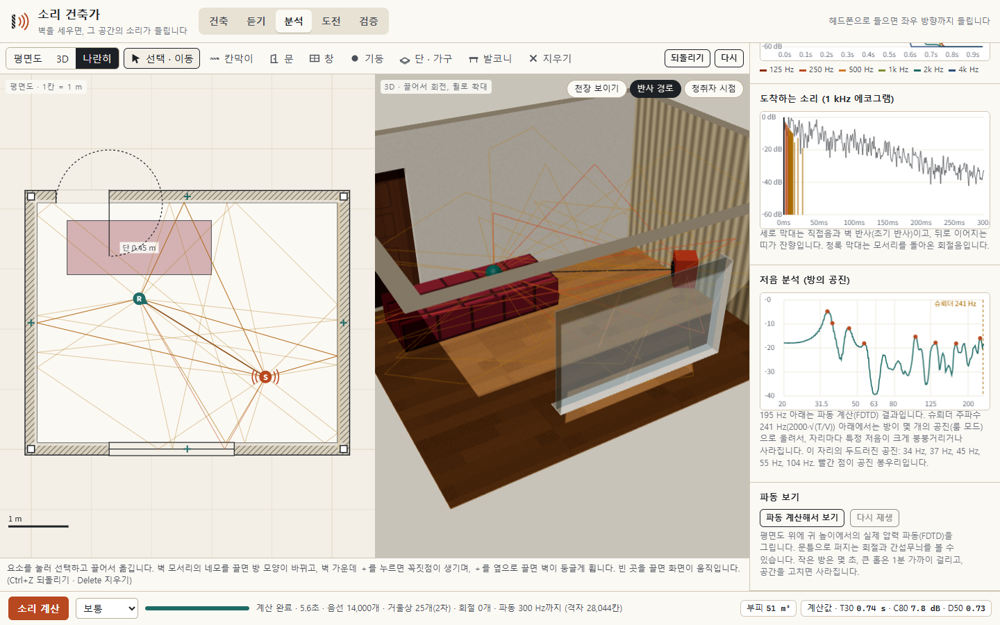
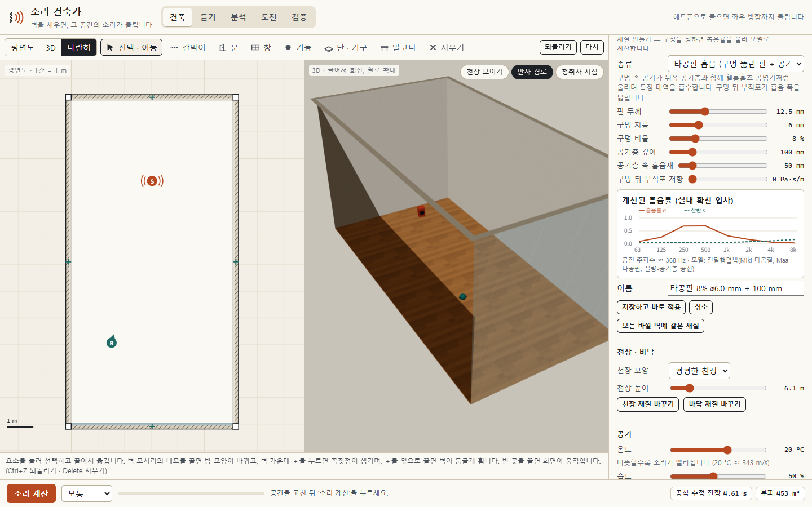
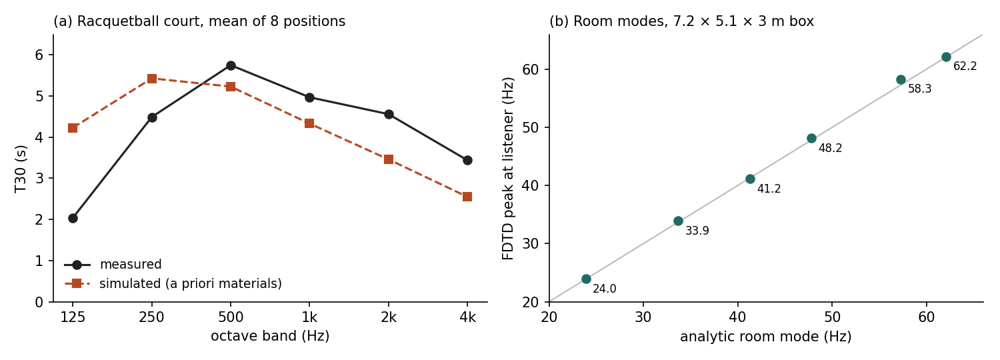

# sound-architect

[](https://github.com/kraewon7422/sound-architect/actions/workflows/ci.yml)
[](https://kraewon7422.github.io/sound-architect/)
[](#quick-start)
[](LICENSE)

A room-acoustics simulator that runs in the browser. You build a room from real walls and
materials, the engine computes its impulse response, and you **hear** the room by playing anechoic
recordings through it. The numbers are checked against closed-form theory, published references and
a measured room.

* **Geometry**: thick walls with mitred corners, curved walls, doors and windows with jambs and
  leaves, partitions, columns, platforms, balconies, and flat, shed, gable or vaulted ceilings.
* **Propagation**: image sources for early reflections, UTD edge diffraction, and stochastic ray
  tracing for the late tail. A 3-D FDTD wave solver covers the low frequencies, with
  frequency-dependent wall impedances.
* **Materials**: 36 tabulated materials (63 Hz–8 kHz), plus a transfer-matrix model that computes
  absorption from the actual construction (porous layer, panel on an air cavity, perforated plate,
  curtain). A built-in editor uses it to design new materials.
* **Output**: binaural auralisation (WebAudio convolution), ISO 3382-1 metrics, decay curves, an
  echogram, a 20–300 Hz room-mode analysis, and an animated pressure field.

[**▶ Try the live demo**](https://kraewon7422.github.io/sound-architect/). Headphones are
recommended. The interface is in Korean.



*Analysis view of a small room. Left: the floor plan with traced reflection paths. Centre: the same
room in 3-D. Right: the 1 kHz echogram and the low-frequency response at the listener. Below the
Schroeder frequency (241 Hz here) the response is computed by FDTD; red dots mark the room-mode
peaks.*

## Quick start

There is no build step and nothing to install. The page loads plain ES scripts and a Web Worker,
so it has to be served over HTTP rather than opened from the file system.

```bash
git clone https://github.com/kraewon7422/sound-architect.git
cd sound-architect
python -m http.server 8790        # Windows: double-click PLAY.cmd
```

Open <http://localhost:8790/>, then:

1. Pick a space (공간 고르기) and edit the walls on the floor plan.
2. Press **소리 계산** (compute).
3. Open **듣기** (listen) and press ▶.

The 3-D view loads three.js r160 from jsDelivr, so it needs an internet connection; everything else
runs offline.

| Tab | What it does |
|---|---|
| 건축 *Build* | plan editor, 3-D view, materials, air temperature, humidity and temperature gradient |
| 듣기 *Listen* | anechoic clips (voice, choir, bassoon, drum, clap…) convolved with the room; A/B against a measured IR |
| 분석 *Analyse* | T30, EDT, C80, D50 and G per octave, decay curves, echogram, low-frequency analysis, wave view |
| 도전 *Challenges* | five design goals (for example "make this lecture hall intelligible") graded on the computed metrics |
| 검증 *Verify* | the verification table below, reproduced in the app |

## Development

```bash
node tests.js                     # physics verification suite (Node ≥ 18, about 2 minutes)
```

In a browser, open `index.html?test=1`. The page title becomes `Tests 22/22`. These tests cover
presets, editing and undo, simulation, recovery from errors, discarding stale results, the material
editor, audio convolution and tab switching.

CI runs `node tests.js` on every push.

### Layout

```
index.html      app: plan editor, 3-D view, listening, analysis, challenges, in-page tests
core.js         acoustics engine, no DOM; shared by the worker and the Node tests
worker.js       runs a simulation off the main thread
materials.js    generated material table + construction parameters for the physical model
tests.js        Node verification suite (34 tests)
audio/          anechoic clips and two measured impulse responses, see audio/LICENSES.md
docs/           README figures
PLAY.cmd        local server launcher for Windows
```

## Model

| Part | Method |
|---|---|
| Early reflections | image sources to order 2–3, with visibility tests against the triangle mesh (BVH) |
| Edge diffraction | UTD (Kouyoumjian–Pathak) for door jambs, partition ends and balcony edges; thin walls are treated as half-planes |
| Late reverberation | stochastic ray tracing with per-octave absorption, Lambert scattering and transmission through walls |
| Low frequencies | 3-D FDTD (standard leapfrog). Walls are locally reacting, with a resistance–mass–spring impedance per material fitted to α at 63–500 Hz (Bilbao 2013). The source has zero net volume. FDTD and geometric results are merged with a zero-phase, power-complementary crossover |
| Materials | transfer-matrix method under field incidence (0–78°): Miki porous layers, limp panels on air cavities, Maa perforated plates with an optional fleece, curtains, single and double glazing |
| Transmission | mass law with a Sharp coincidence model |
| Air | ISO 9613-1 absorption; speed of sound from temperature and humidity; refraction in a vertical temperature gradient (curved rays) |
| Auralisation | Poisson Dirac-sequence late tail, FIR early arrivals with spherical-head ITD/ILD, WebAudio convolution |
| Metrics | ISO 3382-1 (T30, EDT, C80, D50, G), with Lundeby-style correction for truncated decays; Sabine and Eyring for comparison |

The 63 Hz band is missing from most absorption tables, so it is extrapolated from each material's
modelled construction rather than by a fixed factor.



*The material editor: choose a construction (here a perforated plate over a 100 mm cavity with
50 mm of porous fill), and the random-incidence absorption curve is recomputed as the sliders move.
The new material can then be applied to any wall.*

## Verification

`tests.js` checks the engine against closed-form results and independent references. It does not
compare against stored outputs.

| Check | Reference | Result |
|---|---|---|
| Air absorption, 250 Hz–8 kHz | ISO 9613-2 table, 20 °C, 70 % RH | within 10 % |
| Ray-traced T30, diffuse box | Eyring | 0.95–1.04 s vs 0.94–0.98 s |
| Image-source count, box | 6 (1st order), 18 (2nd) | exact |
| Direct sound / FDTD calibration | 1/r | 0.2499 / 0.490 (expected 0.25 / 0.5) |
| UTD knife edge | ITU-R P.526 | within 0.9–1.4 dB |
| FDTD first axial mode | c/2L | 45.25 vs 45.24 Hz |
| Ray bending | circle, R = c/(dc/dz) | 8.49 vs 8.49 m |
| Reverberant-to-direct energy | diffuse theory, 16πr²/R | 11.34 vs 11.21 dB |
| Hybrid merge, 125 Hz energy | geometric only | −1.12 dB |
| Glazed window vs closed room | the glass must be opaque to rays | 2.49 vs 2.53 s (open hole: 1.12 s) |
| Panel absorber resonance | 60/√(m·D) | 60.0 vs 59.9 Hz |
| Perforated-plate resonance | Helmholtz | 278 vs 295 Hz |
| Physical model vs measured tables | rockwool, plasterboard, wood lining and others | rms Δα 0.04–0.16 |
| FDTD wall reflection in a duct | \|(ζ−1)/(ζ+1)\| of the fitted impedance | ±0.05 at 63–125 Hz, ±0.1 at 180–250 Hz |
| Room-mode peaks, 7.2 × 5.1 × 3 m box | analytic modes | within 2 % |

The 180–250 Hz duct error shrinks as the grid is refined (0.10 → 0.08 → 0.05 at 8, 6 and 4 cm), so
it comes from grid dispersion, not from the boundary model.

**Measured room.** A racquetball court (6.10 × 12.19 × 6.10 m, Zenodo 15739328) was rebuilt with
materials chosen *before* looking at the measurements, with no fitting. Results are the mean of
8 source–receiver pairs:



| | 125 | 250 | 500 | 1k | 2k | 4k Hz |
|---|---|---|---|---|---|---|
| T30 simulated (s) | 4.23 | 5.43 | 5.23 | 4.33 | 3.46 | 2.55 |
| T30 measured (s) | 2.04 | 4.49 | 5.75 | 4.97 | 4.56 | 3.44 |
| C80 sim / meas (dB) | −5.4 / −1.3 | −6.0 / −4.6 | −6.1 / −6.9 | −4.8 / −5.6 | −3.8 / −5.2 | −1.6 / −3.0 |

The mid frequencies agree to about 10 %, but the ends do not:

* **125 Hz is too long.** The real court's wall panels absorb bass, and a generic material table
  has no way of knowing that. Switching on the FDTD band does not fix it (5.0–5.4 s), because the
  wave solver can only be as good as the wall impedance it is given.
* **2–4 kHz is too short.** The tabulated plaster absorbs more than this court's walls.

As a labelled what-if, panels on studs give 2.1–2.2 s at 125 Hz but make 250 Hz too short (2.9 s
against 4.2 s), so this is not counted as a match. In the Listen tab you can A/B the simulation
against the measured impulse response.

## Scope

This is geometric acoustics with a wave-based low end, not a full-band wave solver:

* FDTD walls are locally reacting, with one fitted resonator per material, and corner cells take a
  single material.
* Second-order diffraction is modelled only inside the FDTD band.
* Materials come from generic tables, and the constructions used for 63 Hz are typical estimates.
* Ray tracing is Monte Carlo, so T30 varies by roughly 15–25 % between runs at 10 000 rays.
* The natural next steps are extended-reaction walls in the FDTD solver and variance reduction for
  the ray tracer.

## Credits

* Anechoic recordings come from three sources:
  * the OpenAIR Anechoic Database, University of York (CC BY-SA 4.0, via Zenodo 1186905);
  * the racquetball-court study's speech and drum clips and its measured IRs (CC BY 4.0, Zenodo 15739328);
  * Aalto University's anechoic handclaps (CC BY 4.0, Zenodo 22892926).

  Per-file details are in [audio/LICENSES.md](audio/LICENSES.md).
* Absorption data comes from pyroomacoustics `materials.json` (MIT; the values follow Vorländer,
  *Auralization*, annex), RoomTreat (CC BY 4.0) and sengpielaudio. The scattering model follows
  the BRAS benchmark (Aspöck et al.).
* The 3-D view uses three.js r160 (MIT).

## License

The code is released under the [MIT License](LICENSE). The audio files in `audio/` keep their
original Creative Commons licences; see [THIRD_PARTY_NOTICES.md](THIRD_PARTY_NOTICES.md).

---

## 한국어 요약

**소리 건축가**는 벽과 재질로 공간을 짓고 그 공간의 소리를 직접 들어 보는 음향 시뮬레이터예요.

- **계산 방식:** 거울상 반사, 모서리 회절(UTD), 음선 추적으로 공간의 임펄스 응답을 계산해요. 저음은 3차원 파동 계산(FDTD)으로 따로 계산해요.
- **들어 보기:** 무향실에서 녹음한 목소리·합창·악기 소리를 그 공간에 넣어 들려줘요.
- **재질 만들기:** 흡음재 두께, 공기층, 판 무게, 구멍 크기를 정하면 흡음률을 물리 모델로 계산해서 새 재질로 만들어 줘요.
- **검증:** 계산 결과를 이론값, 표준, 실제로 측정한 코트와 비교했어요. 저음(125 Hz)처럼 맞지 않는 부분도 숨기지 않고 그대로 보여 줘요.

[▶ 바로 실행해 보기](https://kraewon7422.github.io/sound-architect/) · 헤드폰을 권장해요.
